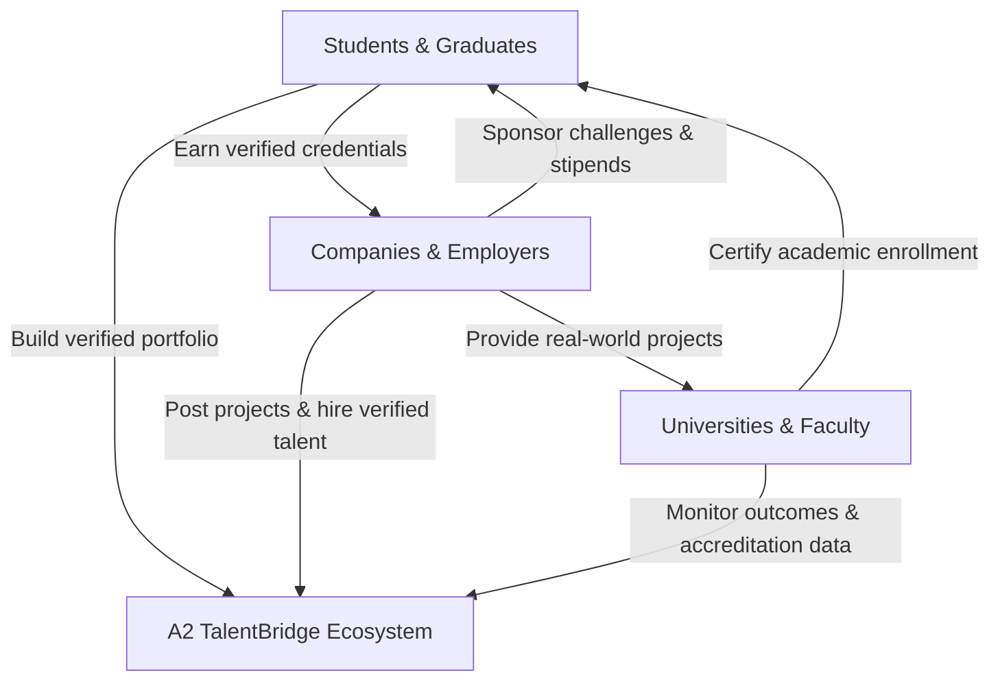

# A2 TalentBridge — Product Strategy & MBA Business Narrative

## 1. Executive Summary & Problem Space
In the Baltic knowledge economy, a systemic misalignment persists between academic institutions and high-growth employers:
- **For Students**: Diplomas provide academic credentials, but lack verified, portfolio-grade evidence of practical competencies, creating a "no experience without a job, no job without experience" paradox.
- **For Employers**: Reviewing unverified CVs and generic job applications incurs substantial recruitment overhead and high mis-hire risk.
- **For Universities**: Higher education institutions face increasing pressure from European accreditation bodies to demonstrate auditable graduate employability metrics and active industry collaboration.

**A2 TalentBridge** solves this structural market friction by introducing a verifiable experiential loop:
$$\text{Education} \longrightarrow \text{Discovery} \longrightarrow \text{Application} \longrightarrow \text{Experience} \longrightarrow \text{Evaluation} \longrightarrow \text{Verified Skills} \longrightarrow \text{Employment} \longrightarrow \text{Impact}$$

---

## 2. The Core Differentiator: Verifiable Experience Engine
Unlike legacy platforms:
* **LinkedIn**: Users claim skills via self-endorsements; verification is social rather than milestone-based.
* **Indeed / Glassdoor**: Aggregates job postings without participating in the skill bridging or experiential workflow.
* **Traditional LMS**: Grades theory without producing market-facing public verification.

**A2 TalentBridge's defensible moat** is its **Mentor Rubric Evaluation Engine**:
1. Employers sponsor live industry challenges or structured internships.
2. Students collaborate in supervised teams to build actual deliverables.
3. Mentors grade deliverables against standardized technical, delivery, and teamwork rubrics.
4. Cryptographic, auditable credentials with unique public registry URLs (e.g., `/verify/A2-LV-2026-X89K`) are minted upon completion.

---

## 3. Multi-Sided Network Effects & Value Proposition

---

## 4. MBA Business Model & Monetization Strategy

| Stakeholder | Pricing Structure | Value Delivered |
| :--- | :--- | :--- |
| **Students** | **Free (100% Free Always)** | Opportunity access, skill bridging, verified digital credentials. |
| **Companies (SMEs & Startups)** | **Freemium Tier** | 1 free active posting per quarter; paid upgrades for featured challenges and talent search. |
| **Companies (Enterprise)** | **Annual Subscription (€2,500 - €10,000/yr)** | Unlimited live challenge sponsorships, direct candidate messaging, structured graduate talent pipelines. |
| **Universities** | **Institutional Partnership Tier (€4,000 - €15,000/yr)** | Faculty dashboard, automated accreditation reporting, corporate partnership tracking. |
| **Sponsored Challenges** | **€1,500 - €5,000 per Challenge Sprint** | Turnkey student sprint management, branding, and solution crowdsourcing. |

---

## 5. Regional Expansion Roadmap

1. **Phase 1 (Current): Latvia Focus**
   - Deep integration with Riga Technical University (RTU), University of Latvia (LU), and Riga Business School (RBS).
   - Localized for `Europe/Riga`, `EUR (€)`, and Latvian regional hubs (Riga, Liepāja, Jelgava, Daugavpils, Valmiera).
2. **Phase 2: Baltic Union Expansion**
   - Expansion into Estonia (TalTech, University of Tartu) and Lithuania (Vilnius University, KTU).
   - Cross-border Baltic student-industry challenges.
3. **Phase 3: Wider European Union Integration**
   - Interoperability with European Digital Credentials for Learning (EDCI) and EBSI blockchain standards.
